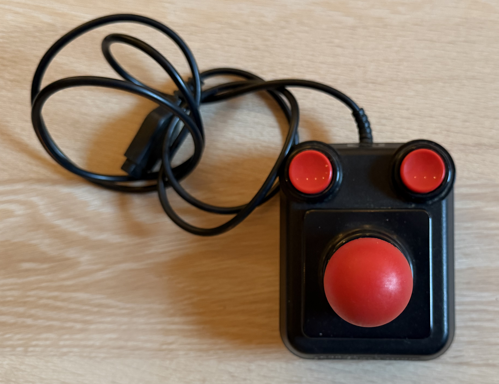
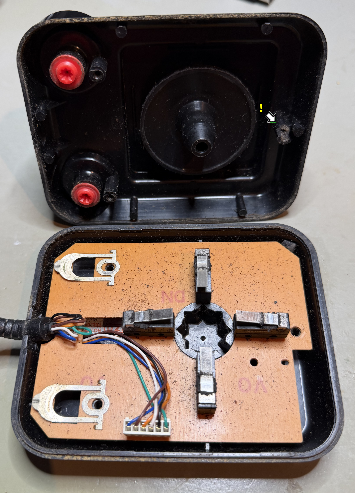
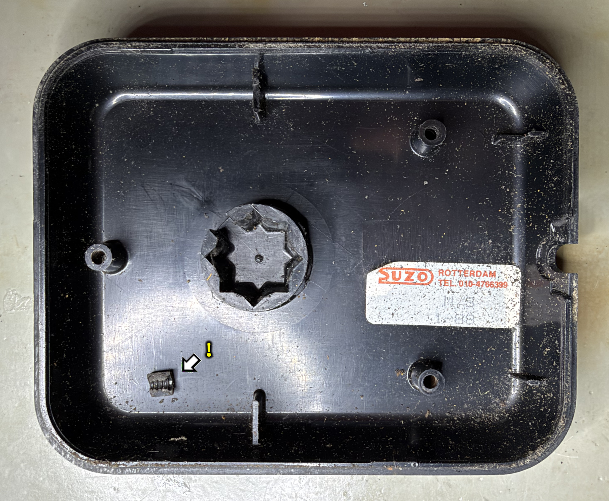

    

# Prof Competition

 

# Table of contents

<!-- TABLE OF CONTENTS -->

TOC - Click to enlarge

  <ul>
    <li>
      <a href="#starting-point">Starting point</a>
    </li>
    <li>
      <a href="#refurbishment-activities">Refurbishment activities</a>
    </li>
    <li>
      <a href="#disassembly">Disassembly</a>
    </li>
    <li>
      <a href="#casing">Casing</a>
    </li>      
    <li>
      <a href="#interior-electronics">Interior electronics</a>
    </li>      
    <li>
      <a href="#cable-and-connector">Cable and connector</a>
    </li>      
    <li>
      <a href="#testing">Testing</a>
    </li>      
    <li>
      <a href="#final-result">Final result</a>
    </li>      
  </ul>

# Starting point

The Prof Competition is a joystick I enjoy more and more. It is very similar to the Competition Pro (which is from another manufacturer), and is made by Suzo International which is famous for "The Arcade" joystick. There are some variations of the Prof Competition joystick, but these variations are primarily on the inside of the joystick.

From a starting point of view, the condition of this joystick can be summarised in one word: dirty. The pictures don´t do this joystick justice - it is more dirty than it looks. There is some kind of fat grime all over it.

Two of the four rubber feet are misaligned. I am not sure if these rubber feet are original from Suzo International, or if these are added by a previous owner at some time.

I do not know if this joystick works or not, but I will clean it properly, both inside and outside before even testing it. Looking past how dirty this joystick is, it does seem to be in good mechanical condition. I can not see any damage to it. There are some marks from use, but nothing significant.

Below are some pictures of the joystick before refurbishment.

    

    

    

    

    

    

# Refurbishment activities

The planned refurbishment activites for this Prof Competition joystick (Order may vary. Several of them in parallell):

- [ ] Refurbish casing
- [ ] Refurbish the interior electronics
- [ ] Refurbish the cable and connector
- [ ] Testing and validation

The plan can be updated during the refurbishment process. Sometimes I discover areas that needs special attention.
 

# Disassembly

To start the disassembly, the two (should be three) screws at the bottom are removed[^1]. Note that these screws are "flat headed" (coned).

    

The top part is lifted from the bottom, and the interior is exposed. Any holy moly! What a sight - and smell! A weird smell - something close to tar - is coming from the interior. There is a huge amount of dirt inside. It is hard to describe, but it is like some "tar" like material has accumulated around the microswitches. How bizarre... Something else I notice during disassembly is that there is a broken screw post (see arrow in picture below).

    

Now the PCB is lifted away and the bottom cover is exposed. The first thing I notice is the missing screw post. I will collect this and try to repair it later. Also, the Suzo International sticker is visible. It is full of dirt, but I think I can discern "88".

    

**Footnotes**
[^1]: Pozidrive flat head (5.5 mm), Sheet metal screw, Fully threaded, Thread diameter: 3.0 mm, Fastener length: 17.5 mm
