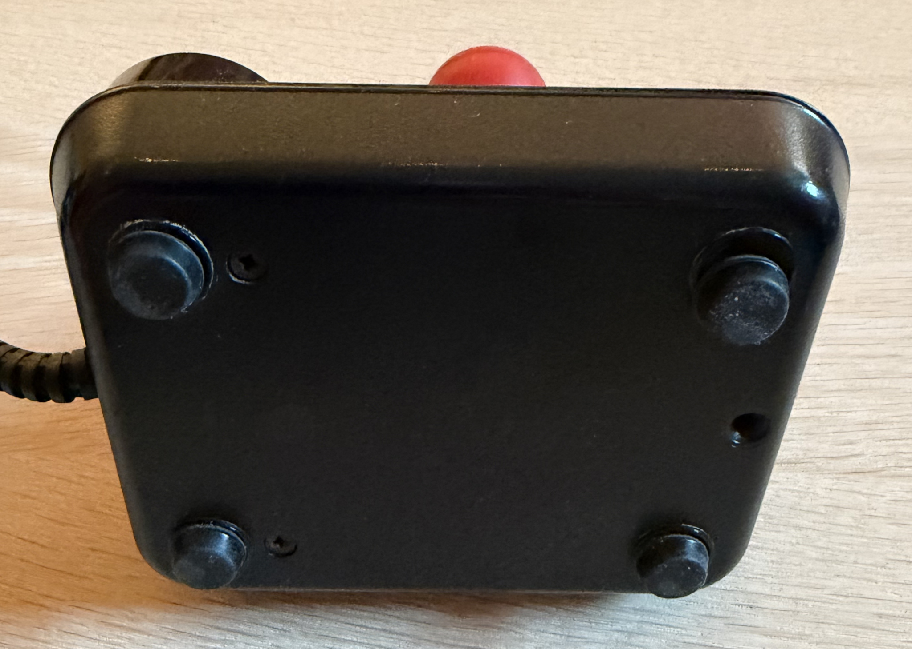

    

# Prof Competition

 

# Table of contents

<!-- TABLE OF CONTENTS -->

TOC - Click to enlarge

  <ul>
    <li>
      <a href="#starting-point">Starting point</a>
    </li>
    <li>
      <a href="#refurbish-activities">Refurbish activities</a>
    </li>
    <li>
      <a href="#disassembly">Disassembly</a>
    </li>
    <li>
      <a href="#casing">Casing</a>
    </li>      
    <li>
      <a href="#interior-electronics">Interior electronics</a>
    </li>      
    <li>
      <a href="#cable-and-connector">Cable and connector</a>
    </li>      
    <li>
      <a href="#testing">Testing</a>
    </li>      
    <li>
      <a href="#final-result">Final result</a>
    </li>      
  </ul>

# Starting point

The Prof Competition is a joystick I enjoy more and more. It is very similar to the Competition Pro (which is from another manufacturer), and is made by Suzo International which is famous for "The Arcade" joystick. There are some variations of the Prof Competition joystick, but these variations are primarily on the inside of the joystick.

From a starting point of view, the condition of this joystick can be summarised in one word: dirty. The pictures don´t do this joystick justice - it is more dirty than it looks. There is some kind of fat grime all over it.

I do not know if this joystick works or not, but I will clean it properly, both inside and outside before even testing it. Looking past how dirty this joystick is, it does seem to be in good mechanical condition. I can not see any damage to it. There are some marks from use, but nothing significant.

Below are some pictures of the joystick before refurbishment.

    

    

    

    

    

    

**Footnotes**
[^1]: Phillips pan head (5.5 mm), Sheet metal screw, Fully threaded, Thread diameter: 3.0 mm, Fastener length: 9.0 mm
